<picture>
  <source media="(prefers-color-scheme: dark)" srcset="assets/contribuicoes-escuro.svg">
  <source media="(prefers-color-scheme: light)" srcset="assets/contribuicoes-claro.svg">
  
</picture>

# Junior Santos

**Desenvolvedor Full Stack**

Aplicações web, plataformas de gestão e integrações com APIs.

[Projetos em destaque](#projetos-em-destaque) · [Competências técnicas](#competências-técnicas) · [Contato](#contato)

  
  

## Estatísticas do GitHub

  
  

## Análise de contribuições

  

## Sobre

Desenvolvo aplicações web com JavaScript, TypeScript e Python, da interface à integração com serviços e bancos de dados. Meus projetos incluem e-commerce, leitura digital, gestão de treinos e organização de conteúdo.

Priorizo interfaces responsivas, fluxos de uso claros e código organizado. Trabalho com autenticação, controle de acesso, persistência de dados, integrações externas e soluções com IA para automatizar tarefas, melhorar a experiência do usuário e apoiar processos de negócio.

## Competências técnicas

| Área | Tecnologias e ferramentas |
| --- | --- |
| **Frontend** | HTML5, CSS3, JavaScript, TypeScript, Tailwind CSS, GSAP e Vite |
| **Backend** | Python, Flask, Node.js, Express e Supabase Edge Functions |
| **Dados e autenticação** | PostgreSQL, SQL, Supabase Auth, Storage e políticas RLS |
| **IA e automação** | Inteligência Artificial, automações, agentes e fluxos com IA |
| **Integrações** | APIs REST, Mercado Pago, Melhor Envio, ViaCEP e Kitsu API |
| **Qualidade e publicação** | Git, GitHub, Playwright, Node.js Test Runner, Vercel e GitHub Pages |

## Projetos em destaque

### [Pupi](https://github.com/JS171555/pupi)

E-commerce para petshop com catálogo, carrinho, conta do cliente e painel administrativo. Inclui pagamento por cartão e Pix dentro do aplicativo, cotação de frete, consulta de CEP e gestão de produtos. [Acesse a aplicação](https://pupi-lovat.vercel.app/).

**Tecnologias:** JavaScript modular, Vite, Supabase, PostgreSQL, GSAP e Lucide.  
**Integrações:** Mercado Pago, Melhor Envio e ViaCEP.

### [NOCTUA](https://github.com/JS171555/noctua)

Experiência sonora minimalista para dispositivos móveis e tablets, com camadas de som que podem ser combinadas para criar atmosferas para dormir, relaxar e se concentrar. [Acesse a aplicação](https://noctua-psi.vercel.app/).

**Tecnologias:** React 19, TypeScript, TanStack Start, Vite, Tailwind CSS e Supabase.

### [Los Santos Reader](https://github.com/JS171555/los-santos-reader)

Plataforma de leitura digital com biblioteca, leitor de PDF, marcadores e retomada do progresso. Reúne metas de leitura, gamificação e administração do catálogo, com interface responsiva e intuitiva. [Acesse a aplicação](https://js171555.github.io/los-santos-reader/).

**Tecnologias:** HTML, CSS, JavaScript, Supabase, PostgreSQL, PDF.js e GSAP.

### [OTAKU LEVEL](https://github.com/JS171555/otaku-level)

Aplicação para acompanhar animes e organizar uma biblioteca pessoal. Integra o catálogo da Kitsu API a recursos de avaliação, favoritos, progresso, conquistas e ranking. [Acesse a aplicação](https://js171555.github.io/otaku-level/).

**Tecnologias:** HTML, CSS, JavaScript, Supabase, PostgreSQL, Kitsu API e PWA.

### [BOX Jardim Silvina](https://github.com/JS171555/box_jardim_silvina)

Plataforma para a rotina de um espaço de treinamento funcional, com área do aluno e painel do treinador. Permite consultar treinos, registrar presença e resultados e acompanhar a evolução dos alunos. [Acesse a aplicação](https://js171555.github.io/box_jardim_silvina/).

**Tecnologias:** HTML, CSS, JavaScript, Supabase, PostgreSQL e PWA.

## Outros projetos

| Projeto | Proposta |
| --- | --- |
| [Meu Bolso](https://github.com/JS171555/meu_bolso) | Controle financeiro pessoal com receitas, despesas, saldo e organização por categoria. [Acesse a aplicação](https://js171555.github.io/meu_bolso/). |
| [Isa Closet](https://github.com/JS171555/isa_closet) | Vitrine de moda com catálogo, sacola, seleção de tamanhos, atendimento pelo WhatsApp e administração de produtos. [Acesse a aplicação](http://isacloset.online/). |
| [Teatro de Marion](https://github.com/JS171555/teatro_de_marion) | Jogo narrativo de terror surrealista no estilo point-and-click, em desenvolvimento com Construct 3. [Acesse a aplicação](https://js171555.github.io/teatro_de_marion/). |

[Explorar todos os repositórios](https://github.com/JS171555?tab=repositories)

## Como trabalho

- Organizo funcionalidades em módulos e componentes compartilhados para facilitar a manutenção.
- Cuido da navegação, da adaptação ao celular e dos estados de carregamento, erro e sucesso.
- Trato permissões e validações no backend, além das verificações da interface.
- Uso testes automatizados e documentação para apoiar a evolução dos projetos.

## Contato

Aberto a oportunidades profissionais, projetos de desenvolvimento web e colaborações.

**GitHub:** [github.com/JS171555](https://github.com/JS171555)

## Atividade de contribuições

  <picture>
    <source media="(prefers-color-scheme: dark)" srcset="https://raw.githubusercontent.com/JS171555/JS171555/output/github-contribution-grid-snake-dark.svg">
    <source media="(prefers-color-scheme: light)" srcset="https://raw.githubusercontent.com/JS171555/JS171555/output/github-contribution-grid-snake.svg">
    
  </picture>

